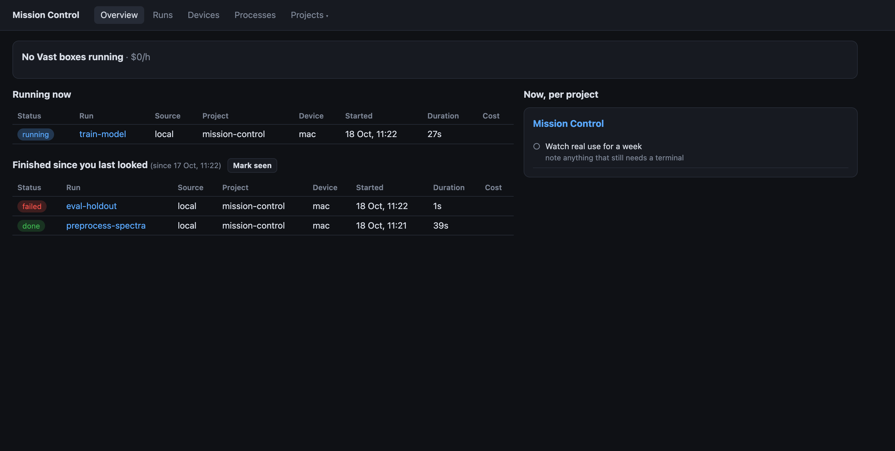
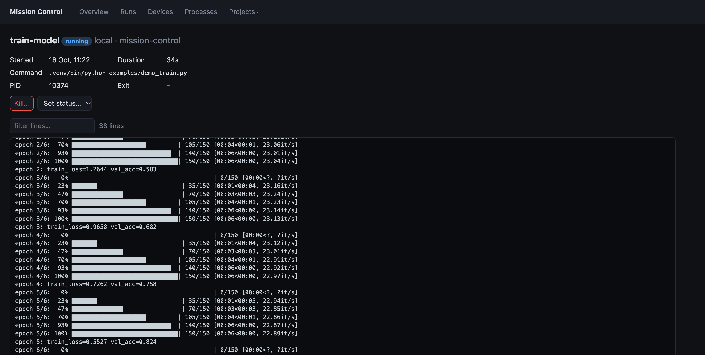
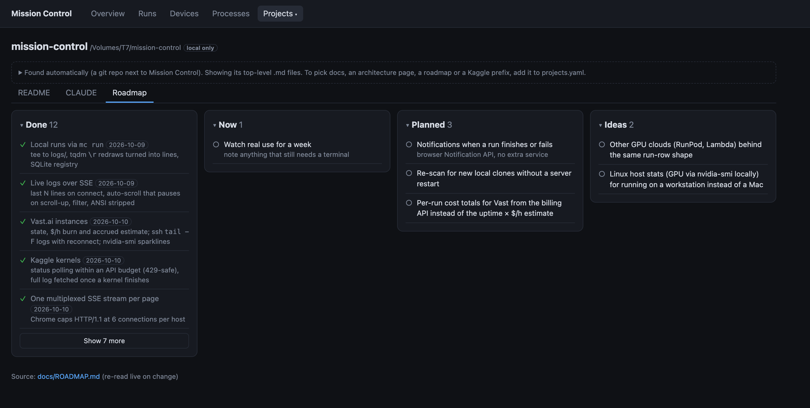
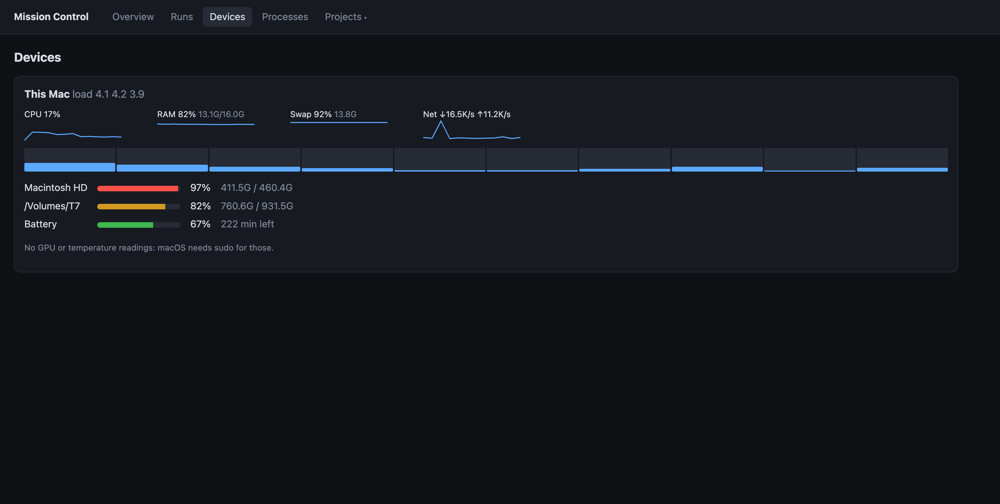
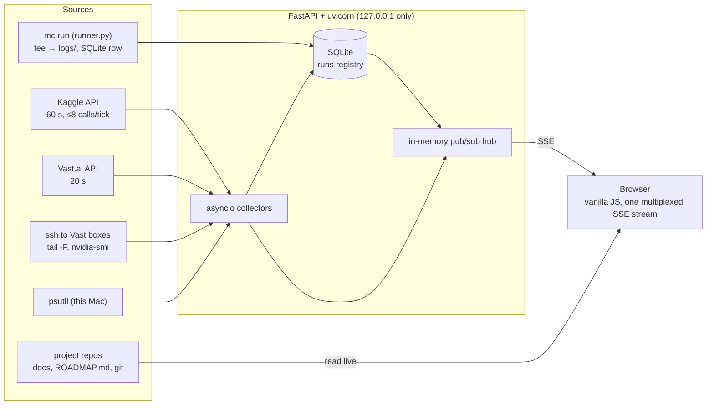

# Mission Control

**A local, live dashboard for ML side projects: every run on your laptop, Kaggle and Vast.ai in one table, with
streaming logs, GPU stats, cloud spend and each repo's docs and roadmap.**

[](https://github.com/poehlers/mission-control/actions/workflows/ci.yml)


[](LICENSE)



Research work ends up spread across a laptop, Kaggle kernels and rented GPU boxes, and keeping track meant a
terminal per box, `ssh … tail -F`, a Kaggle tab and a mental note of which instance was still billing. Mission
Control puts that on one page. It is one Python process, about 1,700 lines with no build step, and uses ~0.5% of
one CPU core when idle so it can run next to real work.

## Features

- **One run table for every compute source.**
  - **Local:** jobs you start with `mc run`.
  - **Kaggle:** kernels, polled within an API budget.
  - **Vast.ai:** instances, with live $/h burn and an estimate of what has accrued.
- **Live logs over Server-Sent Events.**
  - On connect you get the last N lines, then new lines as they arrive.
  - Auto-scroll pauses when you scroll up; there's a filter box; ANSI codes are stripped.
  - tqdm `\r` redraws become normal lines.
  - On Vast boxes the logs are found automatically (`*.log/*.out/*.err`) and followed over ssh with reconnects.
- **Device stats as sparklines:** CPU, RAM, swap, disk, network and battery for the Mac; `nvidia-smi` GPU util, VRAM,
  temperature and power for every running box. Sampled only while a page shows them.
- **Projects:**
  - **Docs:** each repo's markdown is rendered live and re-read on save. Mermaid diagrams render, and a sandboxed
    architecture page can be embedded.
  - **Git panel:** recent commits and uncommitted changes.
  - **Menu:** tracked repos, repos found next to Mission Control, and GitHub-only repos (via `gh`) are listed once each.
- **Roadmap boards** (Done / Now / Planned / Ideas) parsed from each repo's `docs/ROADMAP.md`. Lines that don't fit
  the format are listed above the board instead of being silently dropped.
- **Guarded actions:** kill a local process tree, or stop/destroy a Vast instance.
  - Each action needs an explicit confirm.
  - The server rejects any request that doesn't echo the exact action and run id.
  - Runs stuck in the wrong state (e.g. an old Kaggle version) can be given a status by hand; this only changes the record.

| Live run log | Roadmap board | Devices |
|---|---|---|
|  |  |  |

## Architecture



**Design decisions**

- **SSE, not WebSockets.** Every live channel is one-way push, and `EventSource` reconnects on its own.
- **One multiplexed stream per page** (`/api/stream?t=runs&t=local&t=box:<id>`). Browsers allow only six HTTP/1.1
  connections per host, and a page with a few open streams froze the tab before this.
- **Work only while someone is watching.** Collectors check whether a topic has subscribers, so an idle dashboard
  doesn't ssh into boxes or sample the Mac.
- **Be honest about source limits.** Kaggle has no live log for a running kernel, so the page says so and fetches
  the full log once the kernel finishes. Accrued Vast cost is labelled as an uptime × $/h estimate, not the invoice.
- **Kaggle rate limits are a budget, not retries.** A cold start against ~130 kernels got HTTP 429. The poller now
  spends at most 8 calls per tick, newest unfinished kernels first, and backs off on the first 429.
- **Read-only toward your projects.** Docs, roadmaps and git state are read in place (git with
  `GIT_OPTIONAL_LOCKS=0`). Nothing is copied into the dashboard or written back to the repos.
- **No frontend toolchain.** Plain HTML, JS and CSS, plus two pinned CDN libraries (`marked`, `mermaid`, the latter
  loaded lazily).

## Quickstart

```sh
git clone https://github.com/poehlers/mission-control && cd mission-control
python3.12 -m venv .venv && .venv/bin/pip install -r requirements.txt
cp projects.example.yaml projects.yaml        # optional: edit to track your repos
.venv/bin/uvicorn app:app --host 127.0.0.1 --port 8787
```

Open http://127.0.0.1:8787.

**What it uses if present:**
- **Kaggle:** `~/.kaggle/` credentials.
- **Vast.ai:** `~/.config/vastai/vast_api_key` plus your ssh agent.
- **GitHub repo list:** a logged-in `gh` CLI.

A poller whose CLI isn't configured doesn't start. Without a `projects.yaml`, every git repo in the parent folder
(or `$MC_SCAN_DIR`) still shows up read-only. For development, add `--reload --timeout-graceful-shutdown 1`; SSE
streams never close on their own, so without the timeout a reload hangs.

### Track a local job

```sh
ln -s "$PWD/mc" ~/.local/bin/mc                          # once; any dir on PATH works
mc run train --project myproj -- python train.py --epochs 10
mc run sweep -- 'python a.py && python b.py'             # one quoted arg = runs through the shell
mc run demo -- python examples/demo_train.py             # try it without a real job
```

**What `mc run` does:**
- Output still prints to your terminal and is also written to `logs/<run-id>.log`.
- The run (pid, command, exit code) appears under **Runs** with a live log.
- Ctrl-C stops the job and the exit is recorded.
- The runner ignores SIGHUP, so closing the terminal doesn't kill the job.
- A run whose process vanishes without a recorded exit is marked `lost`.

### Link cloud runs to a project

- **Kaggle:** kernels whose slug starts with the project's `kernel_prefix` (e.g. `myproj-…`) belong to it. There's one
  row per kernel version.
- **Vast.ai:** label the instance `<project-id>-<what>` (`vastai label instance 123 myproj-sweep`).

### Roadmap format (`docs/ROADMAP.md` in each project)

```md
## Done
- [x] Thing that shipped — short evidence (2026-10-05)
## Now
- [ ] In progress — where it runs
  an indented line continues the note
## Planned
## Ideas
```

## Security model

There is no authentication. The app can kill processes and ssh into rented machines, so it **binds to 127.0.0.1
only**; don't put it behind a proxy.

- **Destructive endpoints** require a custom `X-MC-Confirm: "<action> <run_id>"` header. Browsers can't send that
  cross-origin without a CORS preflight, which the app never allows, so other sites (and the sandboxed architecture
  iframe) can't trigger actions.
- **Kill checks the pid first.** It confirms the pid's process start time matches the run's, so a recycled pid is
  never signalled.
- **Credentials stay with their CLIs.** The Vast instance JSON includes a Jupyter token, so only an allowlist of
  fields ever reaches the database or the browser. Nothing credential-like is logged.
- **Repo files are served through a guard:** no path traversal, no dotfiles, and only a short list of file types.
  GitHub READMEs arrive as HTML that GitHub has already sanitized.

## Tests

```sh
for t in tests/test_*.py; do .venv/bin/python "$t" || break; done
```

Each parser has a small assert-based test against real (redacted) sample input:
- the roadmap markdown
- the tqdm `\r` splitter
- Kaggle status mapping, poll budget and back-off
- Vast instance JSON, `nvidia-smi` output and log discovery
- GitHub remote parsing

CI runs these and also boots the server with no config and no credentials.

## Layout

```
app.py            FastAPI app: routes, SSE hub and streams, collector loops, guarded actions
collectors/       local.py (psutil) · kaggle.py · vast.py (API + ssh) · github.py (gh CLI, repo discovery)
runner.py  mc     `mc run`: launch, tee, register, record exit
roadmap.py db.py  ROADMAP.md parser · SQLite run registry
web/              index.html, app.js, style.css (no build step)
tests/            one test per parser, with real sample input in tests/samples/
```

## Limitations

- macOS host stats (no GPU or temperature without sudo). Linux works for everything else but is less tested.
- New local clones are discovered at server start.
- Kaggle's API reports only a kernel's latest version. Older versions still unfinished when a newer one is pushed are
  marked `superseded`.

## License

[MIT](LICENSE) © 2026 Pieter Oehlers
